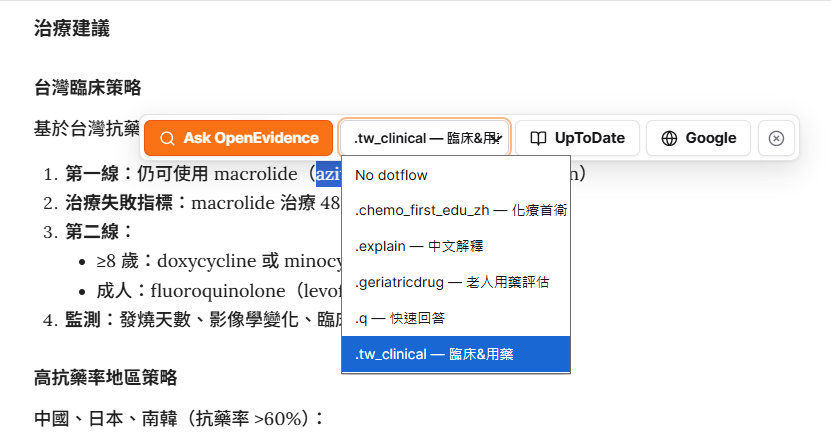

[](https://github.com/htlin222/oe-extension/actions/workflows/release.yml)
[](https://github.com/htlin222/oe-extension/releases)
[](LICENSE)
[](manifest.json)
[](package.json)
[](https://github.com/htlin222/oe-extension/stargazers)

# OpenEvidence Selection Opener

OpenEvidence Selection Opener is a lightweight Chrome extension for clinicians,
students, and evidence-based medicine readers. Select text on a whitelisted page,
click `Ask OpenEvidence`, and the extension opens the selection in OpenEvidence
right next to the current tab. With a validated Groq API key, it can also rewrite
selected recall-style text into editable foreground questions before sending them
to OpenEvidence.

> **Personal fork note (liangRXdev).** This fork adds two features on top of the
> upstream [htlin222/oe-extension](https://github.com/htlin222/oe-extension):
> a **Dotflows** integration (pick one of your OpenEvidence Dotflows and have it
> officially activated on the answer you send) and a **hospital formulary lookup**
> (a `院內` button that matches the selection against your imported in-house drug
> list, entirely offline). Everything else tracks upstream. See
> [Dotflows (fork addition)](#dotflows-fork-addition) and
> [Hospital formulary lookup (fork addition)](#hospital-formulary-lookup-fork-addition)
> below. Maintained for personal use.


## Features

- Selection toolbar anchored above highlighted text.
- `UpToDate` and `Google` buttons to search the selection beside the current tab.
- Right-click `Ask OpenEvidence` context menu for pages and Chrome PDF selection fallback.
- Opens OpenEvidence beside the current tab, optionally in the background.
- Local query history with a dedicated options tab, recording each text sent to OpenEvidence (plus the original selection, prompt, and transformed text for `PICO`/custom rewrites).
- Whitelist-based activation, including `file:///*` support.
- BYOK Groq integration stored in `chrome.storage.local`.
- Built-in `PICO` rewrite flow for evidence-based medicine questions.
- Custom prompt buttons with user-defined names and prompt instructions.
- *(fork)* `院內` button: match the selection against an imported hospital drug list, with same-ingredient and same-ATC-class items — matched locally, nothing is sent out.
- Editable LLM output panel with `Copy`, `Ask OpenEvidence`, and `Close`.
- Optional redirect of NCCN guideline PDF links on OpenEvidence to your own viewer, in a tab and in the side pane alike (*fork:* off by default).
- Light, dark, or system appearance modes.
- No runtime framework, no remote UI dependencies.

## Default Whitelist

```text
https://ankiuser.net/study
https://www.openevidence.com/*
http://uptodate.com/*
nejm.org/*
file:///*
```

Entries are URL prefixes. `*` can be used as a wildcard.

## Install From Release

1. Download the latest `oe-extension-vX.Y.Z.zip` from [Releases](https://github.com/htlin222/oe-extension/releases).
2. Unzip it.
3. Open `chrome://extensions`.
4. Enable Developer mode.
5. Click `Load unpacked`.
6. Select the unzipped extension folder.

The release also includes a `.crx` artifact generated by GitHub Actions.

## Install From Source

```bash
git clone https://github.com/htlin222/oe-extension.git
cd oe-extension
npm test
npm run build
```

Then load `dist/extension` from `chrome://extensions`.

## Local PDF Support

For local PDF files opened in Chrome:

1. Open `chrome://extensions`.
2. Open this extension's details.
3. Enable `Allow access to file URLs`.

Chrome's built-in PDF viewer may not expose selection events to content scripts.
When the floating toolbar does not appear, use the right-click context menu:
select text, right click, choose `Ask OpenEvidence`.

## NCCN Link Redirect

OpenEvidence cites NCCN guidelines as links to `nccn.org` PDFs, which are behind
a login. This extension rewrites those links to a viewer you control, keeping the
guideline slug and page number.

It runs in a full OpenEvidence tab and inside the side pane. Because the side
pane hosts OpenEvidence in an iframe, a redirected link there always opens in a
new tab, so the side pane stays on the conversation.

Configure it under `Settings` in the options page:

- `Redirect NCCN guideline links` turns the rewrite on or off. *(fork)* **Off by
  default** in this fork — upstream turns it on and points to a third-party viewer;
  here NCCN links open as-is until you enable it and set your own template.
- `Redirect URL template` accepts two variables:
  - `$cancer` &mdash; the guideline slug, such as `b-cell`;
  - `$page` &mdash; the page number, defaulting to `1`.

| Target              | Template                                                           |
| ------------------- | ------------------------------------------------------------------ |
| Web viewer          | `https://nccn.hsiehting.com/preview/$cancer?page=$page`            |
| Local (macOS/Linux) | `file:///Users/YOUR_NAME/Downloads/NCCN/$cancer.pdf#page=$page`    |
| Local (Windows)     | `file:///C:/Users/YOUR_NAME/Documents/NCCN/$cancer.pdf#page=$page` |

`file://` templates need `Allow access to file URLs` enabled, as described under
[Local PDF Support](#local-pdf-support).

## Groq BYOK

The `PICO` and custom prompt buttons appear only after a Groq API key is validated.

1. Open extension options.
2. Under `PICO rewrite`, click `Edit`.
3. Paste a Groq API key.
4. Click `Save`.

The key is stored locally with `chrome.storage.local`; it is not committed,
bundled, or sent anywhere except Groq API requests initiated by the extension.

## Custom Prompts

Custom prompts let you create extra buttons beside `Ask OpenEvidence` and `PICO`.
Each custom prompt has:

- a button name, such as `Dx`, `Summarize`, or `Guideline`;
- a prompt that tells Groq how to transform the selected text.

The model output is displayed in an editable panel. You can copy it or ask
OpenEvidence with the edited result.

## Dotflows (fork addition)

> This section describes a feature added in this personal fork; it is not part of
> upstream `htlin222/oe-extension`.

[Dotflows](https://www.openevidence.com) are OpenEvidence's reusable answer
workflows (a saved `explanation_prompt` applied to a question). This fork lets you
attach one of *your own* Dotflows to a question straight from the extension, so the
answer is generated with that Dotflow already active — no manual selection on the
OpenEvidence page.



**How it works**

- The side panel fetches your Dotflow list from
  `https://www.openevidence.com/api/dotflows/dot-flows` using your existing logged-in
  session (`credentials: "include"`), and caches it locally for 30 minutes
  (`chrome.storage.local`, key `oeDotflowsCache`).
- Pick a Dotflow in the floating selector. The extension appends
  `oe_ext_dotflow_id=<id>` to the `openevidence.com/ask` URL it opens.
- A `document_start`, `MAIN`-world content script (`src/dotflow-inject.js`) patches
  `fetch` and `XMLHttpRequest` on that page. When OpenEvidence submits the question
  (`POST /api/article`), it injects `dotflow: { id }` into the request body under the
  confirmed `inputs` schema, then restores the original network functions.
- The injection is one-shot per page load and touches only the matching OpenEvidence
  submit request; all other traffic is untouched.

**Notes / limitations**

- Requires being logged in to OpenEvidence in the same browser profile.
- Relies on OpenEvidence's private `/api/dotflows` and `/api/article` shapes, which
  may change without notice; if activation stops working, append `&oe_ext_debug=1`
  to the `/ask` URL to log every POST endpoint seen and re-verify the schema.
- Scoped to `https://www.openevidence.com/ask*` via `manifest.json` content scripts.

## Hospital formulary lookup (fork addition)

> Fork addition, ported from
> [LCCtaiwan/oe-extension](https://github.com/LCCtaiwan/oe-extension)
> (`feature/hospital-formulary`) with every network lookup removed.

Select a drug name and press **`院內`** (next to `Ask OpenEvidence`). A panel lists:

- **符合品項** — in-house items whose Chinese name, English name, ingredient, or
  in-house code matches the selection.
- **同成分** — other items with the identical 7-character ATC code.
- **同 ATC 分類** — items sharing the 5-character ATC chemical subgroup
  (e.g. `C10AA` statins). This is a classification grouping, **not** a statement of
  therapeutic equivalence or substitutability; the panel says so.
- Click an in-house code to copy it.

**Importing the list**

Options page → **院內品項** tab → choose an `.xlsx` (first worksheet) or `.csv`
(UTF-8 or Big5). The header row is detected automatically within the first 20 rows:

| Field | Accepted headers |
|---|---|
| Name (required, one of) | `藥名` `品名` `藥品名稱` `中文品名` / `英文品名` |
| In-house code | `CODE` `院內代碼` `藥品代碼` `批價碼` `藥碼` |
| Ingredient | `成分` `主成分` |
| ATC | `ATC` `ATC碼` |

Rows with no name are skipped; a malformed ATC (e.g. `A02AB;A02AX`) is kept for
name matching but not used for grouping. Importing a new file replaces the list;
a failed import keeps the previous one.

**Privacy**

- The list is stored only in `chrome.storage.local` on this computer — not synced,
  not uploaded.
- Matching runs inside the page's content script; the selected text is **never**
  sent to any server. This is deliberate: a selection on a web-based HIS page can
  include patient identifiers. (The upstream port's RxClass / Groq / Google Sheet
  features were removed for this reason.)

**Limitations**

- Chinese matches need the full product name or a contiguous part of it; a whole
  Chinese sentence won't match.
- Foreign brand names not stocked in-house can't be resolved (no RxNorm lookup).
- Salt / hydrate words (`hydrochloride`, `maleate`, …) and `anti-xxx` terms are
  ignored for matching.

## OpenEvidence URL

The extension opens selections with this URL shape:

```text
https://www.openevidence.com/ask?query=<selected text>&configName=prod&attachments=%5B%5D&_rsc=1pln2
```

## Release Workflow

Release packaging runs on GitHub release creation/publication:

- runs the test suite;
- builds `dist/oe-extension-v<version>.zip`;
- packs `dist/oe-extension-v<version>.crx`;
- uploads both files as release artifacts.

For stable CRX IDs across releases, add a repository secret named
`CRX_PRIVATE_KEY_BASE64` containing the base64-encoded Chrome extension private
key. Without that secret, CI still generates a `.crx`, but Chrome may assign a
new extension ID.

## Development

```bash
npm test
npm run build
```

The project is intentionally plain Manifest V3 JavaScript, CSS, and HTML.

## Citation

If you use this project, please cite it:

```bibtex
@software{lin2026oeextension,
  author = {Lin, Hsieh-Ting},
  title = {oe-extension: OpenEvidence selection helper for Chrome},
  year = {2026},
  url = {https://github.com/htlin222/oe-extension},
  version = {0.1.2}
}
```

## License

This project is licensed under the [MIT License](LICENSE).
